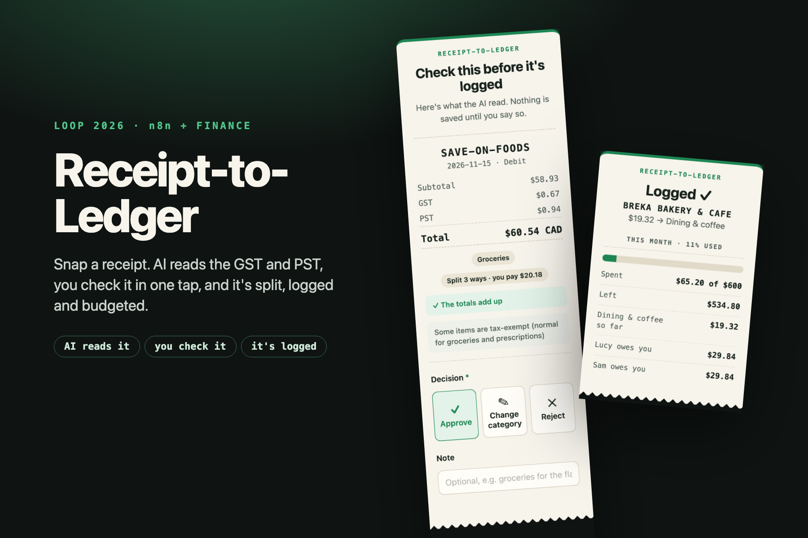
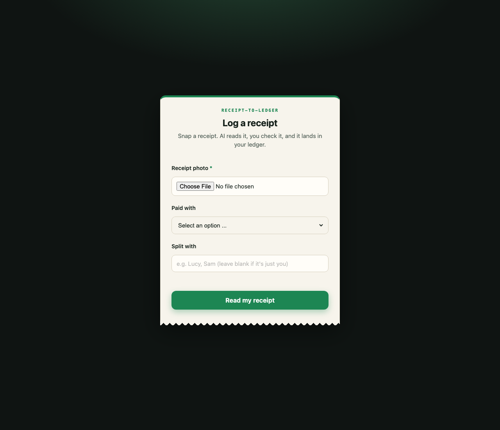
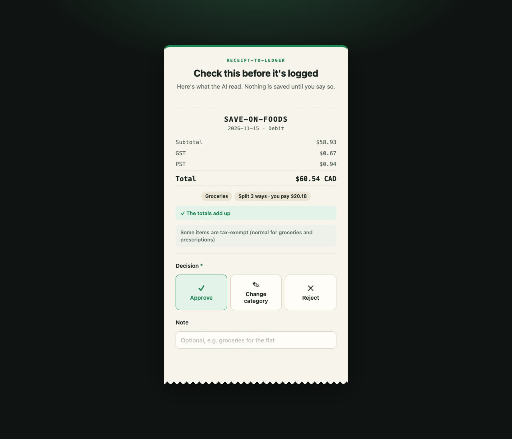
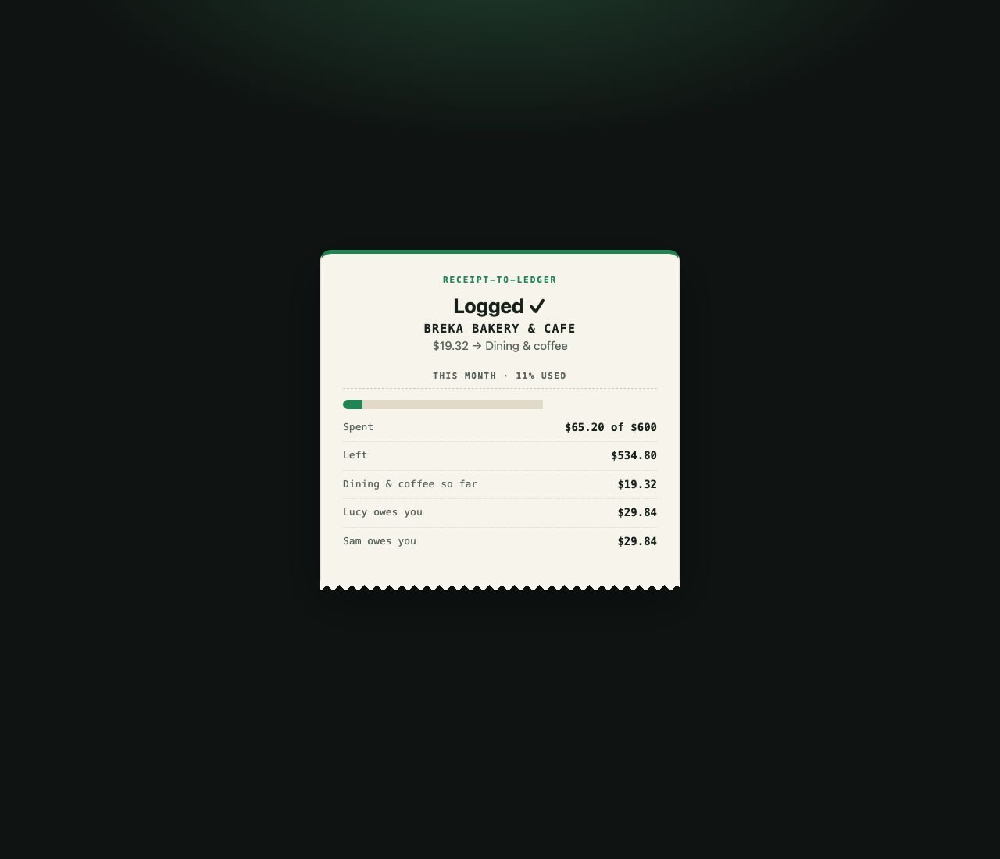
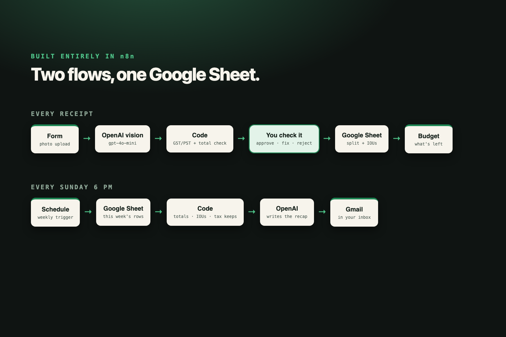

# Receipt-to-Ledger

**Snap a receipt. AI reads it. You approve it in one tap. It lands in your ledger.** Built entirely in n8n for the UBC eProjects × n8n LOOP buildathon (2026) by Braxton Hauw and Lucy Liu.

▶️ **Demo video:** https://youtu.be/3-x6X6M5cFs · 🏁 **Devpost:** https://devpost.com/software/receipt-to-ledger

| Upload | Check what the AI read | Logged + budgeted |
|---|---|---|
|  |  |  |

**What it does**
- AI vision reads the store, date, subtotal, GST, PST and total, and suggests a category.
- Code checks the math (subtotal + taxes = total, GST is 5%) and notes tax-exempt items.
- A human approves, re-categorises or rejects before anything is saved.
- Splits with roommates and tracks who owes you; only your share counts toward your budget.
- Flags receipts to keep for taxes (medical expense credit, tuition).
- Every Sunday, an AI-written recap of your week.

---

## Set it up yourself

Snap a receipt. AI reads the store, the amounts and the GST/PST split. You check it in one tap. It goes into your Google Sheet ledger, split with roommates if you shared it, with the receipts worth keeping for taxes flagged. On Sundays you get an email recap.

Team: Braxton Hauw, Lucy Liu. Built with n8n.

### Steps

**1. Accounts (you do these yourself, all free, no card)**
- n8n: go to n8n.io and start the free cloud trial. The trial includes free OpenAI credits, so you don't need an API key.
- Devpost: open loop.devpost.com, click Join, then create a project and add Lucy as a teammate.
- Lucy: ask an organizer or the Discord whether a remote teammate is allowed.

**2. The Google Sheet (2 min)**
- Make a new Google Sheet and call it `Receipt Ledger`.
- Rename the first tab to `Ledger`. The name must match exactly.
- Paste the line from `ledger-headers.csv` into row 1, then use Data → Split text to columns.

**3. Import the workflow (5 min)**
- In n8n, choose Create workflow → ⋯ menu → Import from file → `workflow/receipt-to-ledger.json`.
- Open both **AI** nodes ("Read receipt (AI)" and "Write the nudge (AI)"). Under Credential, pick **n8n free OpenAI API credits**.
- Open the 3 **Google Sheets** nodes (pick the document, then the tab from the list):
  - Credential: Create new → Sign in with Google.
  - Document: paste your sheet's URL.
  - Sheet: `Ledger`.
- Optional: open "Email the digest", connect Gmail and put your email in **To**. Skip this if you're short on time; in the demo you can just say "and every Sunday it emails you".

**4. Test (10 min)**
- Click **Test workflow**. A form opens.
- Upload a receipt photo (jpg or png), type `Lucy` in "Split with" and submit.
- A second page shows what the AI read and whether the totals add up. Pick Approve.
- The final page should say "Logged ✓" with your budget, and a new row should appear in the sheet.
- Do 3–4 receipts so the budget numbers look real.
- If a node goes red, screenshot it and send it to Claude.

**5. Record the video, 3 min max** (follow `demo-script.md`). Use QuickTime → New Screen Recording, upload to YouTube as **Unlisted**, and paste the link into Devpost.

**6. Devpost** (copy from `devpost.md`):
- Attach the workflow file, or link a GitHub repo.
- Tick the tracks: n8n Track and Investly Finance Track.
- Submit.

## What's in here
- `workflow/receipt-to-ledger.json` is the n8n workflow, with 17 nodes in two flows:
  - **Receipt flow:** form → AI vision reads the receipt → code checks the math → human check page → approve/reject branch → Google Sheet → budget math → confirmation page.
  - **Weekly flow:** Sunday 6 PM → read the ledger → totals by category and IOUs → AI writes a short note → Gmail.
- `ledger-headers.csv` holds the sheet columns.
- `devpost.md` is the write-up, ready to paste.
- `demo-script.md` is the 3-minute video script.

Budget: $600 a month, set in the "Budget math" node (`const BUDGET = 600`). Change it to anything.
